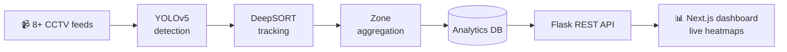

<div align="center">


<br/>

<a href="https://www.linkedin.com/in/sayan-g-600ab5307/"></a>
<a href="mailto:sg777631@gmail.com"></a>
<a href="https://leetcode.com/sayan27"></a>


<br/><br/>

<!-- Impact strip -->


</div>

---

## 🧭 About Me

<table>
<tr>
<td width="58%" valign="top">

```python
class SayanGhosh:
    role      = "AI/ML Engineer — Computer Vision & Full-Stack Systems"
    education = "B.Tech CSE @ KIIT  ·  CGPA 8.28 / 10"
    research  = "Qmet Tech × IIT Bombay — PARIMANA, National Quantum Mission"
    industry  = "SDE Intern — National Council of Science Museums (Govt. of India)"

    def philosophy(self):
        return "A model isn't done until it survives real cameras, real lighting, real crowds."

    def open_to(self):
        return ["CV / ML Engineering roles", "Research collaborations", "Hackathon teams"]
```

</td>
<td width="42%" valign="top">

**🔭 Working on** — robust multi-object tracking under occlusion & crowd density

**🌱 Exploring** — quantum-enhanced feature extraction, edge inference optimisation

**⚡ Track record**
- 🏭 Production CV system, 8+ feeds
- ⚛️ +15% robustness vs. classical baselines
- 🏆 5+ wins · 2 Best Papers (incl. ICAECT 2025)

</td>
</tr>
</table>

---

## ⚡ Tech Arsenal

<div align="center">

<br/>
<br/>


</div>

| Domain | Stack |
|:--|:--|
| 🧠 **Machine Learning** | PyTorch · TensorFlow · Scikit-learn · Deep Learning · Predictive Modeling · Anomaly Detection |
| 👁️ **Computer Vision** | OpenCV · YOLOv5 · DeepSORT · MediaPipe · Multi-Object Tracking · Real-Time Analytics |
| ⚛️ **Research** | Hybrid Quantum-Classical Imaging · Feature-Extraction Benchmarking |
| 🌐 **Full-Stack & Cloud** | Flask · Next.js · React · Firebase · REST APIs · MySQL · MongoDB · Docker · CI/CD · Azure |

---

## 🚀 Featured Builds

### 🏛️ Musealytics — real-time visitor analytics, *live in production at NCSM*

<p>


</p>



| Metric | Result |
|:--|:--|
| Detection accuracy (visitor analytics) | **90%+** |
| Manual CCTV monitoring effort | **−60%** |
| Manual analysis effort (via live heatmaps) | **~−50%** |
| Scale | **8+ feeds · 1,000+ visitors/day** |

<br/>

### 🚇 MetroNav — crowd intelligence & smart ticketing for metro systems

<p>


</p>

- 🔥 **Coach-level congestion heatmaps** driven by crowd-prediction models
- 🎫 **Smart ticket booking** with live train tracking
- 🔄 **Firebase real-time sync** for load balancing and route planning

---

## 💼 Experience

<details open>
<summary><b>⚛️ Quantum Imaging Research Intern</b> — Qmet Tech × IIT Bombay · <i>Apr–May 2026</i></summary>
<br/>

*PARIMANA project, National Quantum Mission*

- Designed **hybrid quantum-classical CV pipelines** for feature extraction
- Achieved **+15% feature-extraction robustness** over classical baselines
- Benchmarked across **3+ research datasets**

</details>

<details open>
<summary><b>🏛️ Software Development Engineer Intern</b> — NCSM, Ministry of Culture, Govt. of India · <i>May–Jul 2025</i></summary>
<br/>

- Shipped a **real-time CV platform**: 8+ feeds, 1,000+ daily visitors
- Built the full path: **ML inference → REST API → DB/analytics → dashboard**
- Delivered **IoT automation** (HVAC/lighting) → **30% energy-cost reduction**

</details>

---

## 🏆 Achievements

<div align="center">

| 🥇 BIS-Nexus Hackathon 2025 | 📄 Best Paper — ICAECT 2025 | 🎯 Build with India Hackathon |
|:---:|:---:|:---:|
| **Winner** out of 200+ teams | International conference | **Top 5,000** of 25,000+ teams |

**5+ hackathon wins · 8+ national/state runner-up finishes across 13+ competitions**<br/>
**Microsoft Build 2024 — Azure & Cloud Skills Challenge**

</div>

---

## 📊 GitHub Analytics

<div align="center">


</div>

---

<div align="center">

### 📫 Let's build something that works in the real world

<a href="https://www.linkedin.com/in/sayan-g-600ab5307/"></a>
<a href="mailto:sg777631@gmail.com"></a>

<sub>⭐ If a repo here helps you, a star is appreciated.</sub>


</div>
